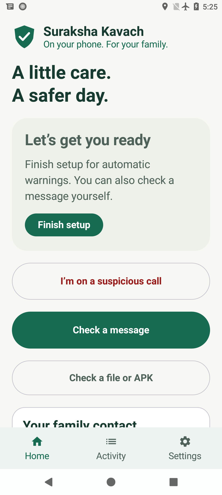
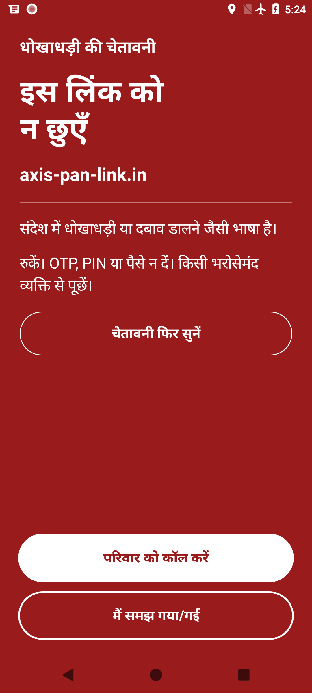

# Suraksha Kavach

An offline Android scam shield for families, built for SatHack with Kotlin and Material 3. English, Hindi and Punjabi UI; English, Hindi, Hinglish and Punjabi scam-language detection. Android 8.0 / API 26 and newer.

The app provides link and message warnings, APK/file inspection, and a family code-word/callback screen. Detection stays on the phone. Guardian SMS is optional and needs working SMS service.

  
  
  

Screens captured from the Android 8 test emulator. The Punjabi image uses 2.0× system font size; reasons scroll and the two bottom actions stay visible.

## Build and try it

Open this repository in Android Studio. Use JDK 17 and Android SDK 36. The two Gradle modules are :core (pure Kotlin/JVM) and :app.

~~~powershell
.\gradlew.bat :core:test :app:testDebugUnitTest :app:assembleDebug :app:lintDebug
~~~

The installable debug APK is at app/build/outputs/apk/debug/app-debug.apk. First-time builds download dependencies; running the detector does not. Gradle uses one worker and a 1 GB heap for this development machine.

Start with [the demo checklist](docs/DEMO_CHECKLIST.md), [phone tests](docs/PHONE_TESTS.md), and [repeatable emulator checks](docs/DEVICE_TESTS.md). The debug build includes held-out examples under Settings > Simulate a message. Keep **Demo mode OFF** for real scoring. Explicit demo mode assigns every extracted URL the same clearly labelled TEST verdict and never sends guardian SMS.

## What is implemented

| Result / feature | Behavior |
|---|---|
| SAFE | No warning notification or sound |
| SUSPICIOUS | Yellow notification with a plain-language reason |
| DANGEROUS | Large red warning, static local voice warning, guardian dial button and dismiss button |
| Background alerts | Android full-screen notification when permitted; an optional dismissible overlay while unlocked |
| Notification scanning | SMS/default SMS app, WhatsApp and WhatsApp Business previews; own notifications and group summaries ignored |
| Local models | Portable URL forest and character n-gram text model; JSON scored directly by Kotlin |
| History | Room + SQLCipher; verdict, domain, timestamp, reason codes only; 500-row bound and 1/7/30-day retention |
| Guardian | Encrypted number, explicit SMS opt-in, generic message, one attempt per 30 minutes across restarts |
| File/APK scan | Android share target or file picker; streaming SHA-256 and native APK permission/component metadata |
| Optional folder watch | User-selected Downloads subfolder; bounded, non-recursive checks scheduled by Android |
| Suspicious call | Ask for the family code word, hang up, and call the saved number |
| Settings | Language, permissions, voice, protection pause, retention, clear-all-data and Enhanced mode |

Full-screen behavior depends on Android version, lock state and permissions. A notification can be tapped when Android does not open the red activity. Audio respects Silent/DND and notification volume. A guardian SMS status reports Android's send result, not proof that someone read it.

The app warns about risk; link navigation and APK installation remain under the user's control. Voice-clone analysis, call recording, speech detection and default-browser/tap interception are **Tier 3 and have not been implemented**.

## Privacy and offline behavior

- Incoming and pasted message bodies, complete URLs and senders are never written to history, files or logs. A bounded queue holds notification text briefly in memory.
- History has exactly four fields: level, domain, timestamp and reasonCodes. File entries use a blank domain and a file reason code, without a filename or hash.
- A random database passphrase and the guardian number are wrapped with Android Keystore AES-GCM. The family code is stored only as a versioned salted PBKDF2-HMAC-SHA256 hash (210,000 iterations, random 128-bit salt, 256-bit result), additionally encrypted.
- Settings and rate-limit counters are local. The optional watched-folder URI is encrypted. Clear all data removes this configuration and releases the folder grant.
- APK/ZIP metadata inspection temporarily uses private cache, deletes its copy afterward, and cleans interrupted-inspection leftovers before the next scan. The archive is never installed or executed.
- Android backup/data transfer is disabled. Production windows use FLAG_SECURE. No analytics, ads, remote scoring or ML runtime is included.
- **Enhanced mode starts OFF.** An explicit refresh downloads the repository's public domain list over HTTPS. It sends no URLs, messages, domains from history, files, hashes, or query parameters.
- Airplane mode supports detection, visual warnings, bundled audio and history. Guardian SMS requires working carrier/SMS service and can fail or queue without it.

## Detection and training

The URL pipeline uses exact registrable-domain allowlisting with the ICANN/private Public Suffix List, a bundled training-derived phishing-domain set, lexical heuristics, and a trained ExtraTrees model. Brand-name subdomains, deceptive registrable domains, IDNs/lookalikes, IP hosts, suspicious TLDs, unusual length/hyphens, shorteners and credential-style paths contribute real signals. A trusted domain does not suppress a separate scam-language warning.

The text model uses character 3–5-grams and logistic regression. URL removal and normalization are identical in Python and Kotlin. The app never consults an example's expected verdict to classify it.

Splits are grouped by registrable domain or normalized message template, with separate train/validation/test partitions. Thresholds are chosen on validation data. Demo inputs are composed only from held-out rows. A preprocessing correction and re-evaluation on the unchanged test partition are disclosed in the reports.

| Held-out evaluation | Test rows | Precision | Recall | F1 | FPR |
|---|---:|---:|---:|---:|---:|
| Full URL alert pipeline | 41,112 | 99.84% | 98.92% | 99.38% | 0.0915% |
| Text alert classifier | 1,284 | 99.35% | 95.05% | 97.15% | 0.2081% |

These are dataset results. Indic messages are synthetic; Punjabi has only 76 held-out templates. SMS spam is an imperfect proxy for scams. These figures do not establish field accuracy.

Metrics, confidence intervals, split fingerprints and measured latency are in [ml/reports](ml/reports); see [METRICS.md](ml/reports/METRICS.md) and [training instructions](ml/README.md). No benchmark result is presented as a physical-phone result.

On the Android 8 emulator, all 50 Python/Kotlin parity rows matched at 1e-10. Warm evaluation measured 2.26 ms median and 5.02 ms p95; loading the models took 3.78 seconds and is reported separately. The actual phone still needs timing.

## Safe file testing and limits

The starter hash set contains **only the harmless standard 68-byte EICAR test signature**. It is not a comprehensive malware database. EICAR has its own test explanation and never notifies a guardian.

APK rules inspect requested SMS, overlay, install-package, accessibility-service and device-admin access, plus names such as challan, KYC and PM-Kisan. Combinations can produce a dangerous verdict even after renaming. These are warning signs, not proof of malicious code. Scans are limited to 100 MB; unreadable archives receive caution. ZIP payloads and executable code are not analyzed.

The unsigned dummy fixture contains only AndroidManifest.xml and an empty resources.arsc table, with hasCode=false and no components. It is never installed. Its [source](tools/fixtures/AndroidManifest.xml), [builder](tools/build_dummy_apk.py) and [checksum](docs/validation/dummy-apk.json) are included. Tests generate EICAR bytes only as harmless test input. No phishing page or real malware was built, downloaded or executed.

The optional folder watcher checks new direct children, up to 20 per run in a folder of at most 1,000 entries. It relies on provider modification dates and Android scheduling, roughly every 15 minutes. Android 11+ requires choosing a subfolder rather than the Downloads root. Manual scanning remains available when a provider cannot supply dates/access. This is a best-effort convenience.

## Validation and phase checkpoints

[docs/PHASES.md](docs/PHASES.md) and [docs/validation](docs/validation) record the Phase 0–5 builds, tests and APK checksums.

Current completed checkpoint: 31 core tests, 7 Python tests and 14 unique Android API 26 emulator tests pass. The separate large-font check and optimized-release smoke test also pass. Airplane mode with no active default network was verified, including an actual virtual-SMS notification reaching the listener and red warning. Debug/release builds and lint pass; all bundled native libraries have 16 KB ELF/ZIP alignment. These checks were repeated after the malformed-link follow-up.

The Android 16 Linux/KVM run passed all 13 standard checks, 50-row parity and the 2.0× font check, including the five UI checks that failed on the Windows host. Its separate virtual incoming-SMS test timed out after the listener connected and is being investigated; full Android 16 notification coverage is still pending. Physical-phone checks, carrier SMS delivery and native-speaker audio review remain pending.

Android instrumentation substitutes an in-memory SMS sender so tests cannot contact anyone. Only the test application disables secure-window screenshot protection. The debug-only file provider exposes deliberate test fixtures; it is absent from release builds.

## Libraries, datasets and APIs used

Project source code is MIT-licensed. Third-party libraries and data retain the upstream terms listed below; the project license does not replace those terms.

Direct versions are pinned in [gradle/libs.versions.toml](gradle/libs.versions.toml). The complete resolved library inventory, including transitive runtime, test and compiler dependencies, is in [docs/DEPENDENCIES.tsv](docs/DEPENDENCIES.tsv) and listed below. Regenerate it with Gradle's dependencyInventory task and [tools/dependencies.init.gradle](tools/dependencies.init.gradle).

| Tool / direct component | Version | Purpose / upstream license |
|---|---|---|
| Kotlin and Compose compiler | 2.2.20 | Kotlin/Compose compilation; Apache 2.0 |
| Android Gradle Plugin | 8.13.2 | Android builds; Apache 2.0 |
| Gradle | 8.13 | Build/wrapper; Apache 2.0 |
| Android SDK / aapt2 / emulator / ADB | compile/target 36; fixture aapt2 36.1.0 | Android platform/build/testing tools; Android SDK terms and component notices |
| JDK / Temurin | 17 | JVM/build; GPLv2 with Classpath Exception |
| AndroidX Core KTX | 1.17.0 | NotificationCompat and platform helpers; Apache 2.0 |
| AndroidX Activity Compose | 1.11.0 | Activities/UI; Apache 2.0 |
| AndroidX Lifecycle Compose | 2.9.4 | Lifecycle integration; Apache 2.0 |
| Compose BOM | 2025.10.01 | UI, Foundation, Material 3, icons and test versions; Apache 2.0 |
| AndroidX SavedState | 1.3.3 | Overlay composition state; Apache 2.0 |
| AndroidX Room | 2.8.5 | Encrypted history interface; Apache 2.0 |
| KSP | 2.2.20-2.0.4 | Room code generation; Apache 2.0 |
| SQLCipher Android | 4.10.0 | Native encrypted SQLite; upstream wrapper/SQLCipher notices and BSD-style SQLCipher license |
| SQLite | bundled by SQLCipher | Database engine; public domain |
| OpenSSL | 3.0.17, identified in the packaged native library | SQLCipher crypto provider; [Apache 2.0](https://openssl-library.org/source/license/index.html) |
| kotlinx.coroutines | 1.10.2 | Async processing; Apache 2.0 |
| kotlinx.serialization JSON | 1.9.0 | Portable JSON models; Apache 2.0 |
| JUnit | 4.13.2 | JVM/device tests; EPL 1.0 |
| AndroidX Test / runner | 1.3.0 / 1.7.0 | Device testing; Apache 2.0 |
| Python | 3.11 for training; scripts compatible with 3.11+ | Offline training/tools; PSF |
| NumPy | 2.2.6 | Training arrays; BSD-3-Clause |
| SciPy | 1.15.3 | Sparse matrices; BSD-3-Clause |
| scikit-learn | 1.7.2 | ExtraTrees and logistic regression; BSD-3-Clause |
| joblib | 1.6.0 | Training dependency; BSD-3-Clause |
| threadpoolctl | 3.8.0 | Training thread control; BSD-3-Clause |
| cloudpickle | 3.1.3 | Training dependency; BSD-3-Clause |
| eSpeak NG | 1.52.0 | Local build-time generation of English/Hindi/Punjabi WAV warnings; GPL-3.0. Engine is not in the APK |
| GitHub Actions | checkout@v4, setup-java@v4, setup-python@v5, setup-gradle@v4, upload-artifact@v4, download-artifact@v4 | CI; respective upstream licenses |
| [Android Emulator Runner](https://github.com/ReactiveCircus/android-emulator-runner) | v2, pinned to 4c44018e59b437e86cdfc41da381398f93ed8808 | Linux emulator CI; Apache 2.0 |

Generated WAV scripts, tool provenance and hashes are in [tools/warning_scripts.json](tools/warning_scripts.json), [tools/generate_audio.py](tools/generate_audio.py) and [docs/validation/audio.json](docs/validation/audio.json). The audio is static; original messages are never sent to a speech engine.

### Datasets and bundled lists

| Source | Use / declaration |
|---|---|
| [PhiUSIIL, UCI 967](https://archive.ics.uci.edu/dataset/967/phiusil-phishing-url-dataset), Prasad & Chandra (2024) | URL strings/labels; CC BY 4.0. Original labels are inverted to our malicious=1 convention |
| [SMS Spam Collection, UCI 228](https://archive.ics.uci.edu/dataset/228/sms+spam+collection), Almeida & Hidalgo (2011) | English spam/ham proxy; CC BY 4.0 |
| [Tranco](https://tranco-list.eu/) | Popular-domain proxy and 38 reviewed allowlist roots. Provider terms include CC BY 3.0, CC BY-SA 4.0 and CC BY-NC 4.0; this is a noncommercial hackathon/research build |
| [anmolshrivastav/scam_ham_india_14_languages](https://huggingface.co/datasets/anmolshrivastav/scam_ham_india_14_languages) | Synthetic en/hi/hi-Latn/pa; publisher-declared MIT; revision 34e2c413aefd2e8f2a6e93177a155f29733290a5 |
| [sidzzz07/scamshield-dataset](https://huggingface.co/datasets/sidzzz07/scamshield-dataset) | Only Synthetic_Tier_C rows; publisher-declared MIT; revision 059dee884476a45e380808e68d09e74baff67291. Third-party merged rows excluded |
| [Public Suffix List](https://publicsuffix.org/list/) | ICANN/private domain boundaries; Mozilla/contributors, MPL 2.0 |
| [EICAR](https://www.eicar.org/download-anti-malware-testfile/) | Standard harmless test bytes/signature for testing only |

OpenPhish and URLhaus **are not bundled or used in these model results**. Parsers accept appropriately authorized local files. OpenPhish redistribution needs permission; URLhaus download access requires an Auth-Key. No API key is embedded.

[Source manifests](ml/reports/sources_manifest.json) record actual URLs, timestamps and checksums. Public dataset archives were downloaded without visiting their contained links.

### APIs and services

- Android: NotificationListenerService, NotificationCompat/channels/full-screen PendingIntent, WindowManager overlay, KeyguardManager, notification/overlay/battery permission settings, PowerManager, ActivityManager.clearApplicationUserData.
- Local storage/security: Room, SQLCipher, Android Keystore, AES-GCM, SecureRandom, PBKDF2WithHmacSHA256, MessageDigest SHA-256/isEqual, private SharedPreferences and AtomicFile.
- Family/audio: SmsManager with an explicit send-result receiver, ACTION_DIAL, MediaPlayer, AudioManager, AudioAttributes and Android TextToSpeech using an installed offline voice as fallback.
- Files/jobs: ContentResolver, OpenableColumns, DocumentsContract/Storage Access Framework, PackageManager.getPackageArchiveInfo, ZipFile and JobScheduler.
- Models: Kotlin/JDK URI/IDN and Unicode processing; Python scikit-learn export. No on-device ML runtime and no inference API.
- Network: Python urllib HTTPS archive downloads for training; Android HttpURLConnection only for the opt-in repository domain-list download. GitHub hosting/REST and Actions are development services.
- Tests: AndroidJUnitRunner, Compose UI testing, UiAutomation screenshots, ADB and the emulator's virtual SMS console. Test messages never reach a carrier.

### Complete resolved library list

<!-- DEPENDENCY_TABLE_START -->

All 163 resolved library versions

| Library | Version | Scope |
|---|---|---|
| androidx.activity:activity | 1.11.0 | runtime, tests/debug |
| androidx.activity:activity-compose | 1.11.0 | runtime, tests/debug |
| androidx.activity:activity-ktx | 1.11.0 | runtime, tests/debug |
| androidx.annotation:annotation | 1.9.1 | compiler, runtime, tests/debug |
| androidx.annotation:annotation-experimental | 1.5.0 | runtime, tests/debug |
| androidx.annotation:annotation-jvm | 1.9.1 | compiler, runtime, tests/debug |
| androidx.arch.core:core-common | 2.2.0 | runtime, tests/debug |
| androidx.arch.core:core-runtime | 2.2.0 | runtime, tests/debug |
| androidx.autofill:autofill | 1.0.0 | runtime, tests/debug |
| androidx.collection:collection | 1.5.0 | runtime, tests/debug |
| androidx.collection:collection-jvm | 1.5.0 | runtime, tests/debug |
| androidx.collection:collection-ktx | 1.5.0 | runtime, tests/debug |
| androidx.compose.animation:animation | 1.9.4 | runtime, tests/debug |
| androidx.compose.animation:animation-android | 1.9.4 | runtime, tests/debug |
| androidx.compose.animation:animation-core | 1.9.4 | runtime, tests/debug |
| androidx.compose.animation:animation-core-android | 1.9.4 | runtime, tests/debug |
| androidx.compose.foundation:foundation | 1.9.4 | runtime, tests/debug |
| androidx.compose.foundation:foundation-android | 1.9.4 | runtime, tests/debug |
| androidx.compose.foundation:foundation-layout | 1.9.4 | runtime, tests/debug |
| androidx.compose.foundation:foundation-layout-android | 1.9.4 | runtime, tests/debug |
| androidx.compose.material3:material3 | 1.4.0 | runtime, tests/debug |
| androidx.compose.material3:material3-android | 1.4.0 | runtime, tests/debug |
| androidx.compose.material:material | 1.9.4 | tests/debug |
| androidx.compose.material:material-android | 1.9.4 | tests/debug |
| androidx.compose.material:material-icons-core | 1.7.8 | runtime, tests/debug |
| androidx.compose.material:material-icons-core-android | 1.7.8 | runtime, tests/debug |
| androidx.compose.material:material-ripple | 1.9.4 | runtime, tests/debug |
| androidx.compose.material:material-ripple-android | 1.9.4 | runtime, tests/debug |
| androidx.compose.runtime:runtime | 1.9.4 | runtime, tests/debug |
| androidx.compose.runtime:runtime-android | 1.9.4 | runtime, tests/debug |
| androidx.compose.runtime:runtime-annotation | 1.9.4 | runtime, tests/debug |
| androidx.compose.runtime:runtime-annotation-android | 1.9.4 | runtime, tests/debug |
| androidx.compose.runtime:runtime-saveable | 1.9.4 | runtime, tests/debug |
| androidx.compose.runtime:runtime-saveable-android | 1.9.4 | runtime, tests/debug |
| androidx.compose.ui:ui | 1.9.4 | runtime, tests/debug |
| androidx.compose.ui:ui-android | 1.9.4 | runtime, tests/debug |
| androidx.compose.ui:ui-geometry | 1.9.4 | runtime, tests/debug |
| androidx.compose.ui:ui-geometry-android | 1.9.4 | runtime, tests/debug |
| androidx.compose.ui:ui-graphics | 1.9.4 | runtime, tests/debug |
| androidx.compose.ui:ui-graphics-android | 1.9.4 | runtime, tests/debug |
| androidx.compose.ui:ui-test | 1.9.4 | tests/debug |
| androidx.compose.ui:ui-test-android | 1.9.4 | tests/debug |
| androidx.compose.ui:ui-test-junit4 | 1.9.4 | tests/debug |
| androidx.compose.ui:ui-test-junit4-android | 1.9.4 | tests/debug |
| androidx.compose.ui:ui-test-manifest | 1.9.4 | tests/debug |
| androidx.compose.ui:ui-text | 1.9.4 | runtime, tests/debug |
| androidx.compose.ui:ui-text-android | 1.9.4 | runtime, tests/debug |
| androidx.compose.ui:ui-tooling | 1.9.4 | tests/debug |
| androidx.compose.ui:ui-tooling-android | 1.9.4 | tests/debug |
| androidx.compose.ui:ui-tooling-data | 1.9.4 | tests/debug |
| androidx.compose.ui:ui-tooling-data-android | 1.9.4 | tests/debug |
| androidx.compose.ui:ui-tooling-preview | 1.9.4 | runtime, tests/debug |
| androidx.compose.ui:ui-tooling-preview-android | 1.9.4 | runtime, tests/debug |
| androidx.compose.ui:ui-unit | 1.9.4 | runtime, tests/debug |
| androidx.compose.ui:ui-unit-android | 1.9.4 | runtime, tests/debug |
| androidx.compose.ui:ui-util | 1.9.4 | runtime, tests/debug |
| androidx.compose.ui:ui-util-android | 1.9.4 | runtime, tests/debug |
| androidx.compose:compose-bom | 2025.10.01 | runtime, tests/debug |
| androidx.concurrent:concurrent-futures | 1.1.0 | runtime, tests/debug |
| androidx.concurrent:concurrent-futures-ktx | 1.2.0 | tests/debug |
| androidx.core:core | 1.17.0 | runtime, tests/debug |
| androidx.core:core-ktx | 1.17.0 | runtime, tests/debug |
| androidx.core:core-viewtree | 1.0.0 | runtime, tests/debug |
| androidx.customview:customview-poolingcontainer | 1.0.0 | runtime, tests/debug |
| androidx.emoji2:emoji2 | 1.4.0 | runtime, tests/debug |
| androidx.graphics:graphics-path | 1.0.1 | runtime, tests/debug |
| androidx.interpolator:interpolator | 1.0.0 | runtime, tests/debug |
| androidx.lifecycle:lifecycle-common | 2.9.4 | runtime, tests/debug |
| androidx.lifecycle:lifecycle-common-java8 | 2.9.4 | runtime, tests/debug |
| androidx.lifecycle:lifecycle-common-jvm | 2.9.4 | runtime, tests/debug |
| androidx.lifecycle:lifecycle-livedata-core | 2.9.4 | runtime, tests/debug |
| androidx.lifecycle:lifecycle-process | 2.9.4 | runtime, tests/debug |
| androidx.lifecycle:lifecycle-runtime | 2.9.4 | runtime, tests/debug |
| androidx.lifecycle:lifecycle-runtime-android | 2.9.4 | runtime, tests/debug |
| androidx.lifecycle:lifecycle-runtime-compose | 2.9.4 | runtime, tests/debug |
| androidx.lifecycle:lifecycle-runtime-compose-android | 2.9.4 | runtime, tests/debug |
| androidx.lifecycle:lifecycle-runtime-ktx | 2.9.4 | runtime, tests/debug |
| androidx.lifecycle:lifecycle-runtime-ktx-android | 2.9.4 | runtime, tests/debug |
| androidx.lifecycle:lifecycle-viewmodel | 2.9.4 | runtime, tests/debug |
| androidx.lifecycle:lifecycle-viewmodel-android | 2.9.4 | runtime, tests/debug |
| androidx.lifecycle:lifecycle-viewmodel-ktx | 2.9.4 | runtime, tests/debug |
| androidx.lifecycle:lifecycle-viewmodel-savedstate | 2.9.4 | runtime, tests/debug |
| androidx.lifecycle:lifecycle-viewmodel-savedstate-android | 2.9.4 | runtime, tests/debug |
| androidx.profileinstaller:profileinstaller | 1.4.0 | runtime, tests/debug |
| androidx.room:room-common | 2.8.5 | compiler, runtime, tests/debug |
| androidx.room:room-common-jvm | 2.8.5 | compiler, runtime, tests/debug |
| androidx.room:room-compiler | 2.8.5 | compiler |
| androidx.room:room-compiler-processing | 2.8.5 | compiler |
| androidx.room:room-external-antlr | 2.8.5 | compiler |
| androidx.room:room-ktx | 2.8.5 | runtime, tests/debug |
| androidx.room:room-migration | 2.8.5 | compiler |
| androidx.room:room-migration-jvm | 2.8.5 | compiler |
| androidx.room:room-runtime | 2.8.5 | runtime, tests/debug |
| androidx.room:room-runtime-android | 2.8.5 | runtime, tests/debug |
| androidx.savedstate:savedstate | 1.3.3 | runtime, tests/debug |
| androidx.savedstate:savedstate-android | 1.3.3 | runtime, tests/debug |
| androidx.savedstate:savedstate-compose | 1.3.3 | runtime, tests/debug |
| androidx.savedstate:savedstate-compose-android | 1.3.3 | runtime, tests/debug |
| androidx.savedstate:savedstate-ktx | 1.3.3 | runtime, tests/debug |
| androidx.sqlite:sqlite | 2.6.2 | runtime, tests/debug |
| androidx.sqlite:sqlite-android | 2.6.2 | runtime, tests/debug |
| androidx.sqlite:sqlite-framework | 2.6.2 | runtime, tests/debug |
| androidx.sqlite:sqlite-framework-android | 2.6.2 | runtime, tests/debug |
| androidx.startup:startup-runtime | 1.1.1 | runtime, tests/debug |
| androidx.test.espresso:espresso-core | 3.5.0 | tests/debug |
| androidx.test.espresso:espresso-idling-resource | 3.5.0 | tests/debug |
| androidx.test.ext:junit | 1.3.0 | tests/debug |
| androidx.test.services:storage | 1.6.0 | tests/debug |
| androidx.test:annotation | 1.0.1 | tests/debug |
| androidx.test:core | 1.7.0 | tests/debug |
| androidx.test:monitor | 1.8.0 | tests/debug |
| androidx.test:runner | 1.7.0 | tests/debug |
| androidx.tracing:tracing | 1.2.0 | runtime, tests/debug |
| androidx.versionedparcelable:versionedparcelable | 1.1.1 | runtime, tests/debug |
| com.google.auto.value:auto-value-annotations | 1.6.3 | compiler |
| com.google.auto:auto-common | 1.2.1 | compiler |
| com.google.code.findbugs:jsr305 | 2.0.2 | tests/debug |
| com.google.code.findbugs:jsr305 | 3.0.2 | compiler |
| com.google.devtools.ksp:symbol-processing-api | 2.0.10-1.0.24 | compiler |
| com.google.errorprone:error_prone_annotations | 2.26.1 | compiler |
| com.google.guava:failureaccess | 1.0.2 | compiler |
| com.google.guava:guava | 33.2.1-jre | compiler |
| com.google.guava:listenablefuture | 1.0 | runtime, tests/debug |
| com.google.guava:listenablefuture | 9999.0-empty-to-avoid-conflict-with-guava | compiler |
| com.intellij:annotations | 12.0 | compiler |
| com.squareup:javapoet | 1.13.0 | compiler |
| com.squareup:javawriter | 2.1.1 | tests/debug |
| com.squareup:kotlinpoet | 2.0.0 | compiler |
| com.squareup:kotlinpoet-javapoet | 2.0.0 | compiler |
| com.squareup:kotlinpoet-jvm | 2.0.0 | compiler |
| commons-codec:commons-codec | 1.15 | compiler |
| javax.inject:javax.inject | 1 | tests/debug |
| junit:junit | 4.13.2 | tests/debug |
| net.zetetic:sqlcipher-android | 4.10.0 | runtime, tests/debug |
| org.checkerframework:checker-qual | 3.42.0 | compiler |
| org.hamcrest:hamcrest-core | 1.3 | tests/debug |
| org.hamcrest:hamcrest-integration | 1.3 | tests/debug |
| org.hamcrest:hamcrest-library | 1.3 | tests/debug |
| org.jetbrains.kotlin:kotlin-metadata-jvm | 2.2.0 | compiler |
| org.jetbrains.kotlin:kotlin-reflect | 2.0.10 | compiler |
| org.jetbrains.kotlin:kotlin-stdlib | 2.2.0 | compiler |
| org.jetbrains.kotlin:kotlin-stdlib | 2.2.20 | runtime, tests/debug |
| org.jetbrains.kotlin:kotlin-stdlib-common | 2.2.20 | runtime, tests/debug |
| org.jetbrains.kotlinx:kotlinx-coroutines-android | 1.10.2 | runtime, tests/debug |
| org.jetbrains.kotlinx:kotlinx-coroutines-bom | 1.10.2 | runtime, tests/debug |
| org.jetbrains.kotlinx:kotlinx-coroutines-core | 1.10.2 | runtime, tests/debug |
| org.jetbrains.kotlinx:kotlinx-coroutines-core-jvm | 1.10.2 | runtime, tests/debug |
| org.jetbrains.kotlinx:kotlinx-coroutines-test | 1.10.2 | tests/debug |
| org.jetbrains.kotlinx:kotlinx-coroutines-test-jvm | 1.10.2 | tests/debug |
| org.jetbrains.kotlinx:kotlinx-serialization-bom | 1.8.1 | compiler |
| org.jetbrains.kotlinx:kotlinx-serialization-bom | 1.9.0 | runtime, tests/debug |
| org.jetbrains.kotlinx:kotlinx-serialization-core | 1.8.1 | compiler |
| org.jetbrains.kotlinx:kotlinx-serialization-core | 1.9.0 | runtime, tests/debug |
| org.jetbrains.kotlinx:kotlinx-serialization-core-jvm | 1.8.1 | compiler |
| org.jetbrains.kotlinx:kotlinx-serialization-core-jvm | 1.9.0 | runtime, tests/debug |
| org.jetbrains.kotlinx:kotlinx-serialization-json | 1.8.1 | compiler |
| org.jetbrains.kotlinx:kotlinx-serialization-json | 1.9.0 | runtime, tests/debug |
| org.jetbrains.kotlinx:kotlinx-serialization-json-jvm | 1.8.1 | compiler |
| org.jetbrains.kotlinx:kotlinx-serialization-json-jvm | 1.9.0 | runtime, tests/debug |
| org.jetbrains:annotations | 13.0 | compiler, runtime, tests/debug |
| org.jetbrains:annotations | 23.0.0 | runtime, tests/debug |
| org.jspecify:jspecify | 1.0.0 | compiler, runtime, tests/debug |
| org.xerial:sqlite-jdbc | 3.41.2.2 | compiler |

<!-- DEPENDENCY_TABLE_END -->

Original code is covered by [LICENSE](LICENSE). Third-party code, datasets and bundled assets retain their declared terms.
